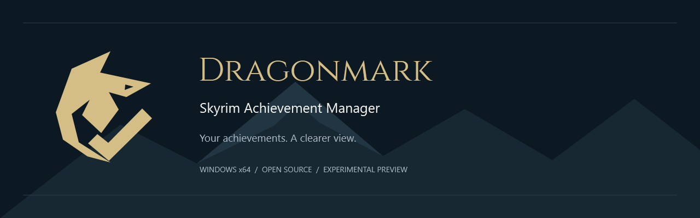
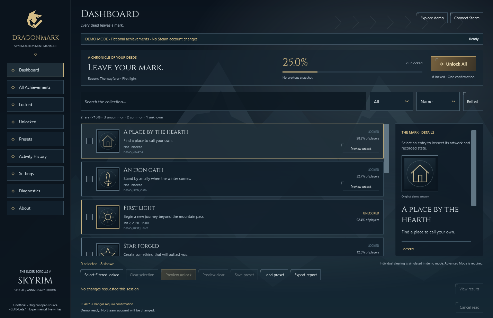
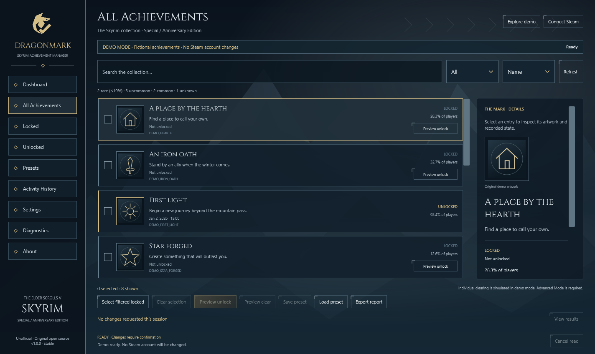
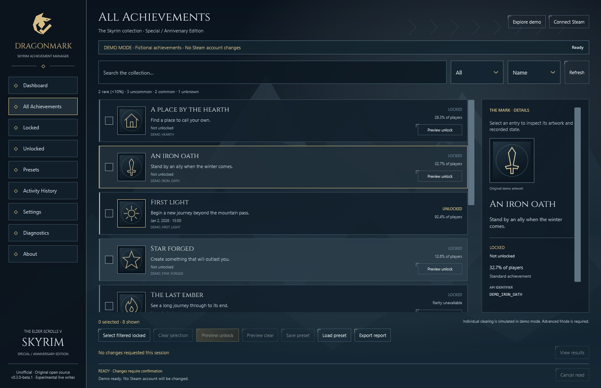
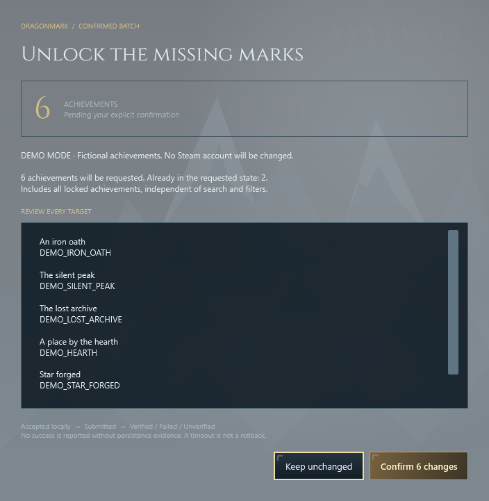
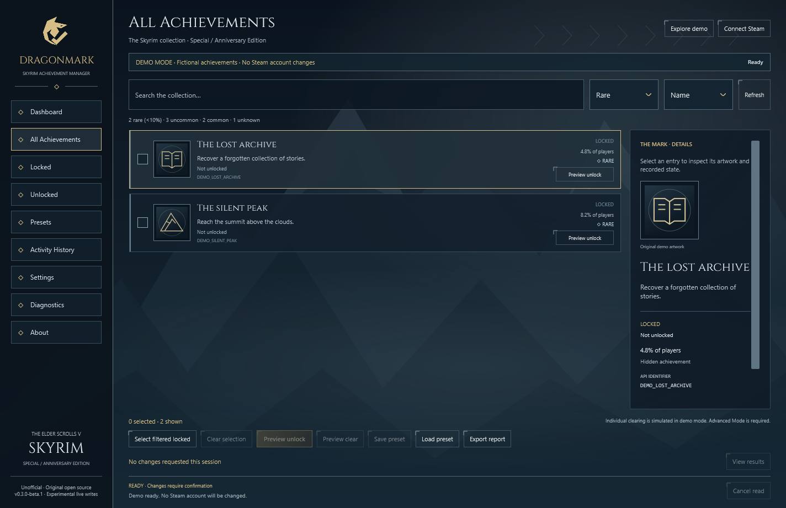
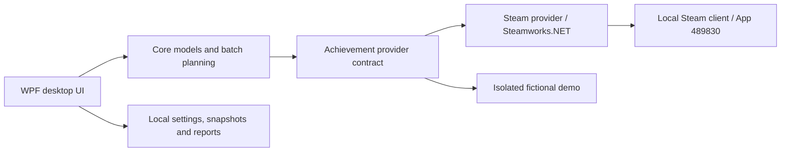

# Dragonmark · Skyrim Achievement Manager



[](https://github.com/Memo-B/dragonmark-skyrim-achievement-manager/actions/workflows/ci.yml)
[](LICENSE)
[](docs/compatibility.md)
[](docs/VALIDATION.md)

**Your achievements. A clearer view.** Dragonmark is an original, English-language Windows desktop app for browsing and managing **Skyrim Special Edition / Anniversary Edition Steam achievements** (App ID **489830**). Inspect your progress, unlock a selection, or review all missing achievements in one confirmed batch.

**Public beta:** live Steam reading and 75 current-state icons were verified locally. On 2026-11-09 the owner reported successful individual unlock and **Unlock All** tests on their account. This is owner-reported live evidence, not a cross-machine certification or an independently observed restart-persistence test. Demo operations never contact Steam.

[English](README.md) · [Türkçe](README.tr.md) · [Installation](docs/installation.md) · [Troubleshooting](docs/troubleshooting.md) · [Contribute](CONTRIBUTING.md)



*Actual application screenshot, isolated demo profile. Fictional achievements; no Steam account data.*


## Explore the interface

| Achievement gallery | The mark in detail |
| --- | --- |
|  |  |
| One explicit confirmation | Search and rarity filters |
|  |  |

All gallery images visibly use **Demo Mode** and original fictional illustrations. Live mode shows authentic Steam artwork in each entry and its details when available: **75/75 current-state icons were retrieved in a read-only local test**, including locked and unlocked entries. Steam artwork is neither repainted nor bundled. [Settings](assets/screenshots/settings.png) · [Diagnostics](assets/screenshots/diagnostics.png) · [Visual system and asset provenance](docs/visual-design.md).

The original mountain atmosphere, OFL-licensed Cinzel headings, engraved frames and frost-white text form one WPF design system. Settings supports reduced motion and an optional user-selected local background; no extracted Skyrim assets are required.
## Get Dragonmark

Download **[Dragonmark 0.3.0-beta.1 for Windows x64](https://github.com/Memo-B/dragonmark-skyrim-achievement-manager/releases/tag/v0.3.0-beta.1)** from the official release page. Choose `Dragonmark-v0.3.0-beta.1-win-x64-Setup.exe` for the guided installer.

1. Download the installer and its `.sha256` file; compare with `Get-FileHash -Algorithm SHA256`.
2. Run Setup. Keep **Download the verified Steam connection component** selected for live use. Internet is required for this small, checksum-pinned download from the official Steamworks.NET source tag. .NET is already included; no SDK or manual DLL copying is needed.
3. Start Steam, sign in to your own account with Skyrim SE/AE, then open Dragonmark and choose **Connect Steam**.
4. Review the list, choose **Unlock All** or a selected unlock, and confirm the displayed targets once.

A portable ZIP is also available; its optional native dependency setup is documented in [installation](docs/installation.md). For offline Demo Mode, deselect the Steam component during Setup. Setup creates a Start Menu shortcut and supports normal Windows uninstallation.

Unsigned preview builds may trigger SmartScreen. Inspect provenance and checksums before deciding whether to run them. Dragonmark requires no administrator privileges or Steam password.

## What works today

| Capability | Status |
| --- | --- |
| Dynamic achievement browser, metadata, search, filters and sorting | Implemented; live discovery verified locally |
| Dashboard progress, rarity and recent unlocks | Implemented; optional Steam metadata may be unavailable |
| Single achievement and selected bulk unlock | Owner-reported live success; broader validation ongoing |
| **Unlock All** / **Unlock Missing** | Owner-reported live success; same missing-only confirmed batch |
| Successful / failed / unverified results with per-target evidence | Implemented and covered by fake-API tests |
| Presets, JSON/CSV exports, account-scoped snapshots, diagnostics | Implemented; imports load selections only |
| Offline fictional demo and individual demo clearing | Implemented; never changes a Steam account |
| Live clearing, full OS/accessibility matrix, stable release | Pending validation; live clearing disabled |

Steam-provided names, descriptions, hidden status, API identifiers, unlock dates, icons and global rarity are displayed when available. All application-owned UI is English; Steam metadata and Windows file dialogs can follow their own language settings. [Roadmap](ROADMAP.md).

## Unlock All, with evidence

1. Connect Steam and inspect the achievement list.
2. Click **Unlock All** on the dashboard. Dragonmark refreshes the **entire** collection and identifies currently locked achievements. No individual selection is needed; search and filters do not restrict this action.
3. Review the target count and scrollable list in **one explicit confirmation dialog**. Cancel makes no changes. An empty batch makes no write.
4. Confirm once. The provider stages accepted targets, calls `StoreStats` once, waits for the matching callback, refreshes user stats and checks each target.
5. Read the separate **successful**, **failed** and **unverified** counts; open **View results** for evidence. The achievement list refreshes after completion.

**Unlock Missing** on the Locked page uses this same operation. For selective unlock, select rows and click **Preview unlock** instead. Duplicate execution is blocked while busy, and no unlock runs at startup. Batches have a two-minute cooldown.

A local API acceptance is never reported as success. A successful store callback **and** matching refreshed state are required. Steam's refreshed cache is not an independent server observation: independent Steam-profile and restart checks remain part of the broader validation plan. A timeout is not a rollback; uncertain writes block further writes in that session. See [Steam integration](docs/steam-integration.md).

## Compatibility

| Environment | Evidence / support |
| --- | --- |
| Windows 11 x64, local build 26300 | Build, demo UI, packaging and real read-only Steam probe tested |
| Windows 10 x64 | Targeted; not tested here |
| Steam Skyrim Special Edition, App ID 489830 | Login/license/context checks and 75 achievements read on one account |
| Anniversary Edition content on App ID 489830 | Same target app; separate AE installation not tested |
| Original Skyrim, Skyrim VR, GOG, Game Pass, consoles | Unsupported |
| SKSE | Not required; no SKSE plugin or bridge exists |

The Steam client must be running, signed in and licensed for the game. No claim is made that every machine, account, or future Steam version will behave identically. [Full compatibility notes](docs/compatibility.md).

## How it works



The Steam provider serializes native calls, checks account/context identity and verifies callback-driven results. Standalone reads have local evidence; live writes remain experimental. No injection, native C++ project, game patch or SKSE bridge is included. [Architecture](docs/architecture.md).

## Build from source

Use **Windows x64**, the **.NET 10 SDK** (see `global.json`) and **PowerShell 7** for repository scripts. No C++ compiler is needed. In the source folder:

```powershell
dotnet restore Dragonmark.sln --locked-mode
dotnet build Dragonmark.sln -c Release --no-restore
dotnet test Dragonmark.sln -c Release --no-build
dotnet run --project src/Dragonmark.App/Dragonmark.App.csproj -c Release -- --demo

# Optional, explicit local Steam setup before rebuilding:
./scripts/Setup-SteamNative.ps1

# Portable local build; copies your supplied native DLL if present:
.\build.bat

# Validate, test, publish self-contained and create a public preview ZIP:
./scripts/Package.ps1
```

Public packaging deliberately excludes `steam_api64.dll`. It pins .NET runtime **10.0.14**, includes license notices and a file manifest, and emits a ZIP plus SHA-256 file under `artifacts/`. ZIP timestamps are not normalized; repeatable inputs do not imply byte-identical archives. [Contributor setup and checks](docs/development.md).

## Security and privacy

Dragonmark uses the authenticated local Steam client; it never asks for a password, Steam Guard code, cookie or Web API key. There is no application telemetry, runtime downloader, service or driver. It does not read or modify Skyrim saves or complete quests.

Settings, cached metadata, account-scoped snapshots and rotating logs live in `%LOCALAPPDATA%\Dragonmark`. Exports contain achievement history. Account scopes are hashed, not anonymous; review reports before sharing. Steam's native diagnostics may expose identifiers outside the app's redaction. The explicit setup script downloads only the pinned native dependency. [Security policy](SECURITY.md).

Third-party achievement modification is not promised to be permitted, reversible or risk-free. Use your own account and make an informed choice.

## FAQ

**Special Edition or Anniversary Edition?** The Steam App ID 489830 is the target for both. SE read access was tested locally; a separate AE installation was not.

**Can I unlock all achievements or only selected ones?** Both paths are implemented. Unlock All targets currently locked achievements; selected unlock targets your selection. Each requires confirmation. The owner reported successful live tests; broader validation is ongoing.

**Must Skyrim be running?** No game process is required by Dragonmark. The Steam client is required for live use. Availability depends on Steam accepting the authenticated app context.

**Is SKSE required?** No. There is no SKSE integration.

**Does this edit saves?** No. A Steam achievement change does not complete an in-game quest.

**Can achievements be reset?** There is no mass reset, `ResetAllStats`, or snapshot rollback. Live individual clearing is disabled until validated; demo clearing is available in advanced mode.

**What happens offline?** Use Explore demo without Steam. Live connection/store failures and timeouts are reported; an uncertain operation is not declared successful and may persist later. Inspect Steam before retrying.

**Why does SmartScreen warn?** Preview binaries are unsigned and have no established signing reputation. Verify the official source and archive checksum; no signing or safety certification is claimed.

**Can I inspect the source?** Yes. The [repository](https://github.com/Memo-B/dragonmark-skyrim-achievement-manager) is the designated public home; the release source and build instructions are available there.

**Is this official?** No. Dragonmark is an independent community project, unaffiliated with Valve, Steam, Bethesda or Microsoft.

## Development and community

Start with [CONTRIBUTING](CONTRIBUTING.md), [development](docs/development.md), [roadmap and starter tasks](ROADMAP.md), [issue templates](.github/ISSUE_TEMPLATE/bug_report.md) and the [code of conduct](CODE_OF_CONDUCT.md). [Open an issue](https://github.com/Memo-B/dragonmark-skyrim-achievement-manager/issues) with redacted evidence. Security concerns follow the separate [disclosure policy](SECURITY.md).

Repository owner: [Memo-B](https://github.com/Memo-B). No additional maintainers or community activity are claimed. [Publishing instructions](docs/PUBLISHING.md) describe the reviewed commit, tag and release process. CI never contacts Steam or changes real achievements.

## License and identity

Original code and the geometric dragon/check artwork are [MIT licensed](LICENSE); existing attribution is preserved. Dependencies have separate [third-party notices](THIRD_PARTY_NOTICES.md). The Valve native library is proprietary and is not covered by the wrapper's MIT license.

[Brand assets and regeneration](assets/branding/README.md) · [Naming research](docs/branding-research.md) · [Notice](NOTICE.md)
