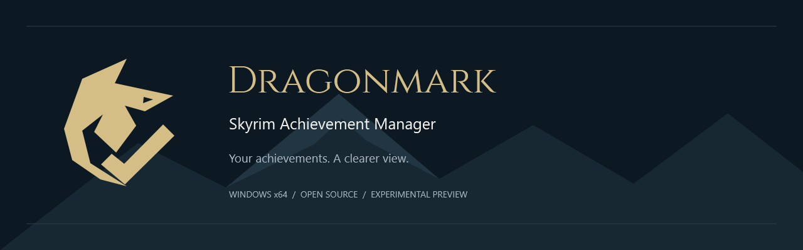
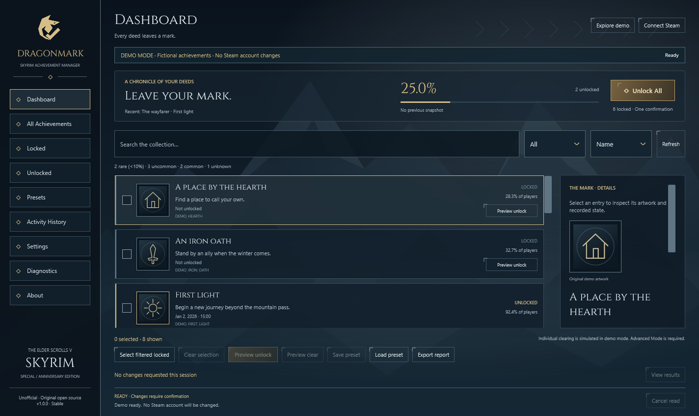
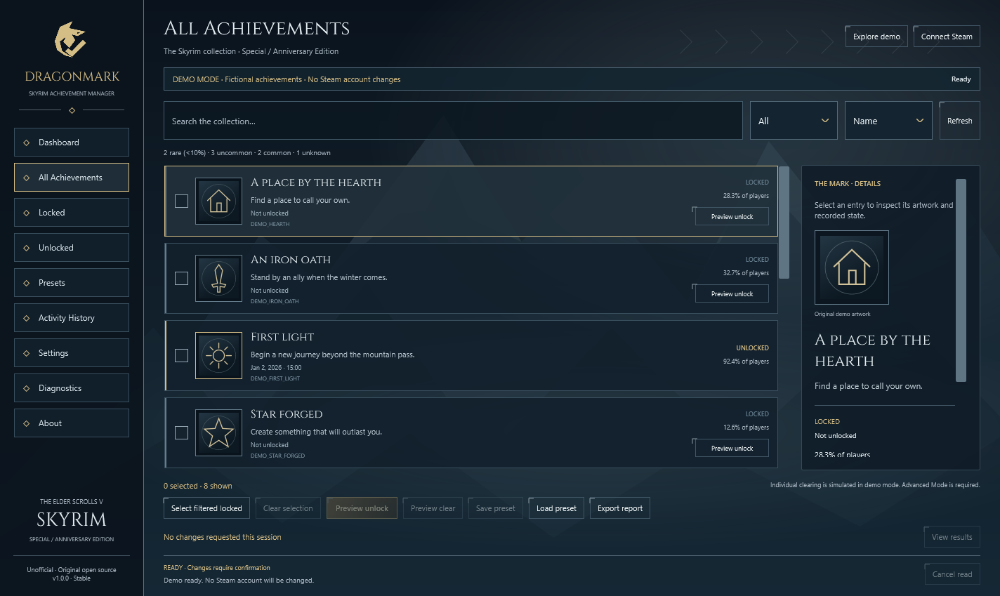
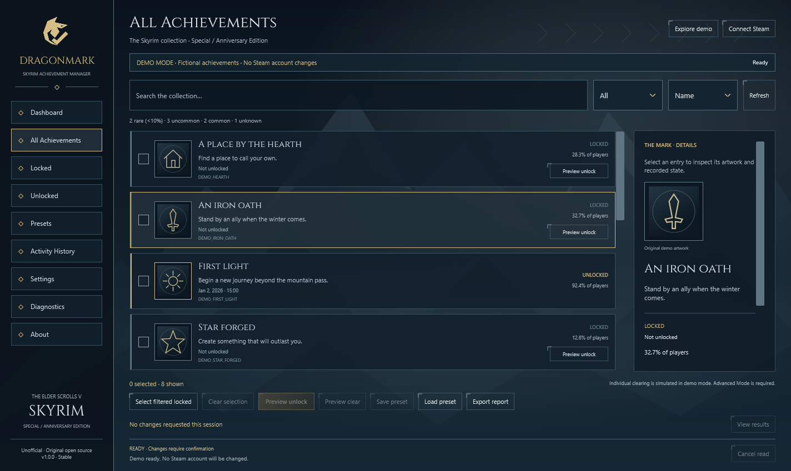
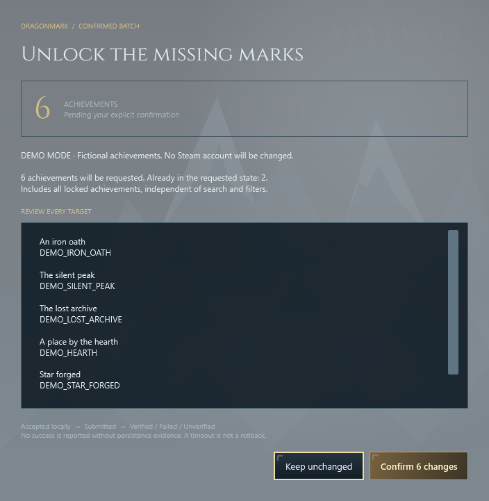
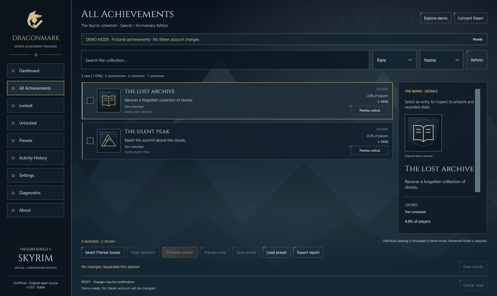

# Dragonmark · Skyrim Achievement Manager



[](https://github.com/Memo-B/dragonmark-skyrim-achievement-manager/actions/workflows/ci.yml)
[](https://github.com/Memo-B/dragonmark-skyrim-achievement-manager/releases/tag/v1.0.0)
[](docs/compatibility.md)
[](LICENSE)

**İlerlemeni gör. Açmak istediklerini seç. Her değişikliği kendin onayla.**

Dragonmark, **Skyrim Special Edition / Anniversary Edition Steam başarımlarını** yönetmek için geliştirilmiş ücretsiz ve açık kaynaklı bir Windows uygulamasıdır. Gerçek Steam görselleriyle koleksiyonunu inceleyebilir, seçtiğin başarımları veya kilitli başarımların tamamını **tek bir açık onayla** açabilirsin.

**[Windows yükleyicisini indir](https://github.com/Memo-B/dragonmark-skyrim-achievement-manager/releases/download/v1.0.0/Dragonmark-v1.0.0-win-x64-Setup.exe)** · **[Sürüm notları ve dosya özetleri](https://github.com/Memo-B/dragonmark-skyrim-achievement-manager/releases/tag/v1.0.0)** · [Taşınabilir ZIP](https://github.com/Memo-B/dragonmark-skyrim-achievement-manager/releases/download/v1.0.0/Dragonmark-v1.0.0-win-x64.zip)

[English](README.md) · [Türkçe](README.tr.md) · [Kurulum](docs/installation.md) · [Sorun giderme](docs/troubleshooting.md) · [Yol haritası](ROADMAP.md)



*Gerçek uygulama, görünür Demo Mode etiketiyle. Hesap verilerini paylaşmamak için ekran görüntülerinde kurgusal başarımlar kullanılır; canlı mod gerçek Steam başarım görsellerini gösterir.*

## Üç adımda başla

1. **Kur.** `Dragonmark-v1.0.0-win-x64-Setup.exe` dosyasını indirip çalıştır. **Download the verified Steam connection component** seçeneğini seçili bırak. .NET pakete dahildir; küçük Steam bileşenini kurulum indirir. SDK, elle DLL kopyalama veya yönetici yetkisi gerekmez.
2. **Bağlan.** Steam'i açıp Skyrim SE/AE'ye sahip hesabına giriş yap. Başlat menüsünden Dragonmark'ı aç ve **Connect Steam** düğmesine bas.
3. **İncele ve aç.** Tek tek başarımlar seç veya **Unlock All** düğmesini kullan. Hedef sayısını incele, bir kez onayla ve sonuçları kontrol et.

Steam bileşeninin indirilmesi ve canlı Steam erişimi için İnternet gerekir. Çevrimdışı incelemek için kurulumda bu bileşeni kaldırıp uygulamada **Explore demo** seçeneğini kullan. Uygulama Windows üzerinden kaldırılabilir; taşınabilir sürüm için [ZIP kurulum rehberine](docs/installation.md) bak.

## Başarım koleksiyonu için tasarlandı

| Özellik | Yapabileceklerin |
| --- | --- |
| **Unlock All / Unlock Missing** | Filtre ve seçimlerden bağımsız olarak tüm kilitli başarımları otomatik bul |
| Seçili açma | Tek başarımı veya seçtiğin grubu inceleyip onayla |
| Gerçek Steam görselleri | Steam'den gelen adları, açıklamaları, simgeleri, açılma tarihlerini ve mevcut nadirlik verisini gör |
| Arama ve filtreler | Ad/API kimliğiyle ara; duruma veya nadirliğe göre filtrele |
| İlerleme ve ayrıntılar | Tamamlanmayı, son açılanları ve her başarımın kayıtlı durumunu incele |
| İncelenebilir sonuçlar | Başarılı, başarısız ve doğrulanamayan sonuçları ayrı ayrı, işlem kanıtlarıyla gör |
| Profiller ve raporlar | Seçimlerini kaydet, incelemek için yükle ve JSON/CSV raporu dışa aktar |
| Özgün masaüstü arayüzü | İskandinav esintili tasarım, lisanslı Cinzel yazı tipi, azaltılmış hareket ve yerel arka plan kullan |
| Çevrimdışı demo | Steam hesabını değiştirmeden kurgusal başarımlarla uygulamayı keşfet |

**Uygulamanın kendi arayüzü tamamen İngilizcedir.** Bu dosya Türkçe kullanım rehberidir. Steam metinleri ve Windows dosya pencereleri kendi dil ayarlarını izleyebilir.

## Test edildi; kanıtları inceleyebilirsin

| Kontrol | Kaydedilen sonuç |
| --- | --- |
| Gerçek Steam okuması | Test edilen kurulumda **75 başarım ve 75 güncel simge** alındı |
| Gerçek başarım açma | Depo sahibi 2026-11-09 tarihinde gerçek hesabında tekli açma ve **Unlock All** işlemlerini denedi, ikisinin de başarılı çalıştığını bildirdi |
| Otomatik davranış testleri | **89 test geçti**; hesap değişimi sınırları, gerçek WPF onay/iptal akışı, odak geçişi ve küçük ekran yerleşimleri dahil |
| Windows yükleyicisi | Kurulum, doğrulanmış Steam bileşeni indirme, açılış, çevrimdışı demo kurulumu ve kaldırma yerel testleri geçti |
| Derleme ve bağımlılıklar | Sıfır hata/uyarı; kilitli bağımlılık ve açık denetimleri geçti |
| GitHub kontrolleri | [İlk main CI çalışması başarılı](https://github.com/Memo-B/dragonmark-skyrim-achievement-manager/actions/runs/42670925791); üstteki rozet güncel durumu gösterir |
| İndirme bütünlüğü | Yükleyici ve ZIP için ayrı SHA-256 dosyası; ZIP içinde dosya bazlı manifest bulunur |

**1.0.0, tamamlanan özellik kapsamının kararlı sürümüdür.** Proje bakım aşamasındadır; yeni özellik geliştirmesi planlanmıyor. Canlı açma kanıtı depo sahibinin manuel testidir. Diğer ortamlar ve bağımsız yeniden başlatma sonrası kalıcılık için doğrulanmamış noktalar [doğrulama kaydında](docs/VALIDATION.md), bakım sınırları [yol haritasında](ROADMAP.md) açıklanır.

## Senin hesabın, senin onayın

Dragonmark açık Steam istemcisini kullanır; Steam parolası, Steam Guard kodu veya Web API anahtarı istemez. Uygulama telemetrisi, servis veya sürücü içermez. Skyrim kayıtlarını düzenlemez ve oyun içi görevleri tamamlamaz.

- **Otomatik açma yok:** uygulamayı açmak, bağlanmak veya profil yüklemek başarım değişikliği başlatmaz.
- **Tek ve açık onay:** Unlock All tüm listeyi yenileyip kilitli hedeflerin sayısını ve listesini gösterir.
- **Doğrulanmış sonuç bildirimi:** API'nin isteği kabul etmesi tek başına başarı sayılmaz; Steam'in kaydetme onayı ve yenilenen hedef durumu birlikte gerekir.
- **Tekrarlı işlem koruması:** aynı anda ikinci işlem engellenir; toplu yazmalar arasında iki dakika beklenir.
- **Belirsizlik gizlenmez:** zaman aşımı veya belirsiz sonuç doğrulanamadı olarak gösterilir; o oturumda yeni yazmalar engellenir. Tekrar denemeden önce Steam'i incele; zaman aşımı geri alma değildir.

Ayarlar ve geçmiş `%LOCALAPPDATA%\Dragonmark` altında tutulur. Raporları paylaşmadan önce incele. Kendi hesabını kullan; değişikliklerin geri alınabileceği garanti edilmez. [Güvenlik ve özel bildirim kanalı](SECURITY.md) · [Steam entegrasyonu](docs/steam-integration.md).

## Arayüz galerisi

| Başarım koleksiyonu | Başarım ayrıntıları |
| --- | --- |
|  |  |
| Tek ve açık onay | Arama ve nadirlik filtreleri |
|  |  |

[Ayarlar](assets/screenshots/settings.png) · [Tanılama](assets/screenshots/diagnostics.png) · [Tasarım ve görsel kaynakları](docs/visual-design.md). Demo çizimleri özgündür; gerçek Steam görselleri canlı modda alınır ve indirme paketlerine eklenmez.

## Uyumluluk ve mevcut sınırlar

| Ortam | Durum |
| --- | --- |
| Windows 11 x64 | Yerel derleme, kurulum ve açılış testleri geçti; sahibinin canlı testi başarılı |
| Windows 10 x64 | Hedefleniyor; daha geniş test bekliyor |
| Steam Skyrim SE / AE, Uygulama Kimliği **489830** | Hedef oyun; ayrı bir AE kurulumu test edilmedi |
| İlk Skyrim, Skyrim VR, GOG, Game Pass, konsollar | Desteklenmiyor |
| SKSE veya açık Skyrim | Dragonmark bunları gerektirmez; Steam açık ve oturum açılmış olmalıdır |
| Canlı başarım sıfırlama | Kapalı; gelişmiş modda yalnızca demo sıfırlama var |

Yükleyici ve uygulama **dijital olarak imzalanmamıştır**; SmartScreen bilinmeyen yayıncı uyarısı gösterebilir. Yalnızca bu deponun sürüm sayfasından indir ve eşlik eden dosya özetini kontrol et. Dragonmark bağımsız bir topluluk aracıdır; resmî Valve veya Bethesda uygulaması değildir. [Ayrıntılı uyumluluk](docs/compatibility.md).

## İndirdiğin dosyayı doğrula

Aynı sürümden yükleyiciyi ve `.sha256` dosyasını indirip karşılaştır:

```powershell
Get-FileHash .\Dragonmark-v1.0.0-win-x64-Setup.exe -Algorithm SHA256
Get-Content .\Dragonmark-v1.0.0-win-x64-Setup.exe.sha256
```

Kurulum, Steam bileşenini sabitlenmiş resmî Steamworks.NET etiketinden HTTPS ile indirir ve SHA-256 eşleşmezse reddeder. Uygulamanın kendisi çalıştırılabilir kod indirmez. Valve DLL'si yayımlanan yükleyici veya ZIP'in içine gömülmez. Dosya özeti bütünlüğü denetler; ilgisiz bir indirme sitesinin güvenilirliğini kanıtlamaz.

## Kaynaktan derleme ve katkı

Windows x64, `global.json` dosyasındaki .NET 10 SDK ve PowerShell 7 kullan:

```powershell
dotnet restore Dragonmark.sln --locked-mode
dotnet build Dragonmark.sln -c Release --no-restore
dotnet test Dragonmark.sln -c Release --no-build
dotnet run --project src/Dragonmark.App/Dragonmark.App.csproj -c Release -- --demo

# İsteğe bağlı yerel Steam bileşeni; ardından yeniden derle:
./scripts/Setup-SteamNative.ps1

# Denetle, ZIP ve yükleyici üret:
./scripts/Package.ps1 -InstallerCompiler 'C:\Path\To\Inno Setup 7\ISCC.exe'
```

WPF arayüzü, işlem planlama, Steam entegrasyonu ve yerel veri katmanları ayrıdır. Paket .NET 10.0.14 ve lisans bildirimlerini içerir. CI kurgusal veriler kullanır; gerçek hesaba yazmaz. [Mimari](docs/architecture.md) · [Geliştirme](docs/development.md) · [Katkı](CONTRIBUTING.md) · [Yayınlama](docs/PUBLISHING.md).

Sorun bulduğunda uygulama/Windows sürümünü, adımları ve kişisel verilerden arındırılmış sonucu ekleyerek [issue aç](https://github.com/Memo-B/dragonmark-skyrim-achievement-manager/issues). Ham hesap günlüğü veya kimlik bilgisi paylaşma. Güvenlik sorunları için [özel bildirim kanalını](https://github.com/Memo-B/dragonmark-skyrim-achievement-manager/security/advisories/new) kullan.

## Lisans ve katkı sahipleri

Özgün kod ve Dragonmark çizimleri [MIT lisanslıdır](LICENSE); önceki atıflar korunur. Cinzel ve bağımlılıkların [ayrı lisansları](THIRD_PARTY_NOTICES.md) vardır. Dragonmark'ın Valve, Steam, Bethesda veya Microsoft ile bağlantısı yoktur. Depo sahibi: [Memo-B](https://github.com/Memo-B).
