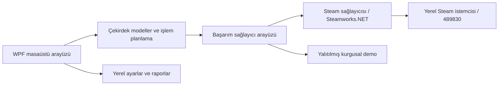

# Dragonmark · Skyrim Achievement Manager


[](.github/workflows/ci.yml)
[](LICENSE)
[](docs/compatibility.md)
[](docs/VALIDATION.md)

**Başarımlarınız, daha net bir görünüm.** Dragonmark, **Skyrim Special Edition / Anniversary Edition Steam başarımlarını** (Uygulama Kimliği **489830**) görüntülemek ve yönetmek için geliştirilmiş özgün bir Windows masaüstü uygulamasıdır. İlerlemenizi inceleyebilir, seçtiğiniz başarımları veya kilitli başarımların tamamını tek bir onaylı işlemde açmayı deneyebilirsiniz. **Uygulama arayüzü tamamen İngilizcedir**; bu dosya Türkçe kullanım rehberidir.

**Genel beta:** Yerel testte Steam bağlantısı, 75 başarım ve simgeleri doğrulandı. Depo sahibi 2026-11-09 tarihinde gerçek hesabında tekli açma ve **Unlock All** işlemlerinin başarılı olduğunu bildirdi. Bu kullanıcı bildirimi, farklı bilgisayarlar veya bağımsız yeniden başlatma sonrası kalıcılık testiyle eşdeğer değildir. Demo işlemleri Steam'e bağlanmaz.

[English](README.md) · [Türkçe](README.tr.md) · [Kurulum](docs/installation.md) · [Sorun giderme](docs/troubleshooting.md)


*Gerçek uygulamadan alınmış demo ekran görüntüsü. Gerçek Steam hesabına ait veri içermez.*


## Arayüz galerisi

| Başarım koleksiyonu | Başarım ayrıntıları |
| --- | --- |
|  |  |
| Tek ve açık onay | Arama ve nadirlik filtresi |
|  |  |

Görüntülerde **Demo Mode** etiketi ve özgün kurgusal çizimler vardır. Canlı mod, kullanılabilir olduğunda gerçek Steam başarım resimlerini kartlarda ve ayrıntılarda gösterir. Salt okunur yerel testte kilitli ve açık durumdaki başarımlar dahil **75/75 simge yüklendi**. Steam resimleri yeniden boyanmaz ve dağıtım paketine eklenmez. [Ayarlar](assets/screenshots/settings.png) · [Tanılama](assets/screenshots/diagnostics.png) · [Tasarım ve görsel kaynakları](docs/visual-design.md).

Özgün dağ siluetleri, OFL lisanslı Cinzel başlıkları, metal çerçeveler ve soğuk beyaz metinler tek bir WPF tasarım sisteminde birleşir. Ayarlardan hareket azaltılabilir ve isteğe bağlı yerel arka plan seçilebilir; Skyrim dosyalarından görsel çıkarılmaz.
## İndirme ve kurulum

**[Windows x64 için Dragonmark 0.3.0-beta.1](https://github.com/Memo-B/dragonmark-skyrim-achievement-manager/releases/tag/v0.3.0-beta.1)** sayfasından `Dragonmark-v0.3.0-beta.1-win-x64-Setup.exe` dosyasını indirin.

1. Yükleyici ve `.sha256` dosyasını indirin; özeti `Get-FileHash -Algorithm SHA256` ile karşılaştırın.
2. Setup dosyasını çalıştırın. Canlı kullanım için **Download the verified Steam connection component** seçeneğini seçili bırakın. Küçük Steam bileşeni resmî Steamworks.NET kaynağından indirilip sabit SHA-256 özetiyle doğrulanır; İnternet gerekir.
3. .NET pakete dahildir; SDK kurmanız veya DLL kopyalamanız gerekmez. Steam'de oyuna sahip hesabınıza giriş yapın, Dragonmark'ı açın ve **Connect Steam** seçin.
4. **Unlock All** veya seçili açma işlemini başlatıp gösterilen hedefleri bir kez onaylayın.

Kurulum Başlat menüsüne kısayol ekler ve Windows üzerinden kaldırılabilir. Çevrimdışı demo için Steam bileşenini kaldırabilirsiniz. Taşınabilir ZIP ve ayrı bağımlılık kurulumu için [kurulum rehberine](docs/installation.md) bakın.

Önizleme imzasızdır; SmartScreen uyarısı çıkabilir. Çalıştırma kararından önce kaynağı ve dosya özetini denetleyin. Yönetici yetkisi veya Steam parolası gerekmez.

## Özellikler ve gerçek durumları

| Özellik | Durum |
| --- | --- |
| Dinamik başarım listesi, arama, filtreleme, sıralama ve ayrıntılar | Uygulandı; canlı okuma yerel olarak doğrulandı |
| İlerleme panosu, nadirlik ve son açılan başarımlar | Uygulandı; isteğe bağlı Steam verileri her zaman bulunmayabilir |
| Tekli ve seçili toplu açma | Depo sahibi canlı testin başarılı olduğunu bildirdi |
| **Unlock All** / **Unlock Missing** | Depo sahibinin canlı testi başarılı; aynı onaylı, yalnızca eksikleri hedefleyen işlem |
| Başarılı, başarısız ve doğrulanamayan sonuçlar | Ayrı gösteriliyor; sahte API ile otomatik testleri var |
| Seçim profilleri, JSON/CSV raporları, anlık görüntüler ve tanılama | Uygulandı; profil içe aktarma yalnızca seçim yükler |
| Kurgusal çevrimdışı demo ve demoda tekli sıfırlama | Uygulandı; Steam hesabını değiştirmez |
| Canlı sıfırlama, geniş uyumluluk ve erişilebilirlik doğrulaması | Bekliyor; canlı sıfırlama kapalı |

Steam'in sağladığı ad, açıklama, gizlilik bilgisi, API kimliği, tarih, simge ve küresel nadirlik uygun olduğunda gösterilir. Steam metinleri ve Windows dosya iletişim kutuları kendi dil ayarlarını izleyebilir. [Yol haritası](ROADMAP.md).

## Tüm kilitli başarımları açma akışı

1. Steam'e bağlanın ve mevcut başarımları inceleyin.
2. Panodaki **Unlock All** düğmesine basın. Uygulama tüm listeyi yeniler ve kilitli başarımları bulur. Tek tek seçim gerekmez; arama ve filtreler hedefleri daraltmaz.
3. **Tek bir açık onay penceresinde** hedef sayısını ve kaydırılabilir listeyi inceleyin. İptal etmek değişiklik yapmaz. Kilitli başarım yoksa yazma işlemi başlatılmaz.
4. Onaydan sonra kabul edilen hedefler hazırlanır, bir kez `StoreStats` çağrılır, ilgili geri çağırım beklenir ve yenilenmiş kullanıcı durumu tek tek kontrol edilir.
5. **Successful**, **Failed** ve **Unverified** sayılarını inceleyin; ayrıntılar için **View results** düğmesini kullanın. Liste işlem sonunda yenilenir.

Locked sayfasındaki **Unlock Missing** aynı işlemdir. Yalnızca seçtiklerinizi açmak için satırları seçip **Preview unlock** düğmesini kullanın. İşlem sürerken ikinci çalıştırma engellenir; açılışta otomatik açma yapılmaz. Toplu işlemler arasında iki dakika bekleme uygulanır.

API'nin isteği kabul etmesi başarı sayılmaz. Başarılı kaydetme geri çağırımı ve yenilenen durumun hedefle eşleşmesi birlikte gerekir. Önbellek okuması bağımsız sunucu kanıtı değildir; gerçek işlem ve Steam profilinden ayrıca doğrulama hâlâ gereklidir. Zaman aşımı geri alma anlamına gelmez; belirsiz işlemden sonra o oturumda yeni yazmalar engellenir.

## Uyumluluk

| Ortam | Kanıt / destek |
| --- | --- |
| Windows 11 x64, yerel derleme 26300 | Derleme, demo, paketleme ve gerçek salt okunur Steam bağlantısı denendi |
| Windows 10 x64 | Hedefleniyor; burada test edilmedi |
| Steam Skyrim Special Edition, 489830 | Tek hesapta bağlam, sahiplik ve 75 başarımın okunması doğrulandı |
| Aynı uygulama kimliğindeki Anniversary Edition içeriği | Hedefleniyor; ayrı AE kurulumu denenmedi |
| İlk Skyrim, Skyrim VR, GOG, Game Pass ve konsollar | Desteklenmiyor |
| SKSE | Gerekmez; SKSE eklentisi veya köprüsü bulunmuyor |

Steam açık olmalı, oturum açılmış olmalı ve hesap oyuna sahip olmalıdır. Tüm sistemler veya gelecekteki Steam sürümleri için uyumluluk garantisi verilmez. [Ayrıntılar](docs/compatibility.md).

## Nasıl çalışır?



Steam işlemleri sıraya alınır; hesap kimliği, uygulama bağlamı, geri çağırımlar ve sonuçlar denetlenir. Bağımsız okuma yolu yerel olarak doğrulandı; yazma işlemleri deneyseldir. Oyun dosyası yaması, enjeksiyon, C++ projesi veya SKSE köprüsü yoktur. [Mimari](docs/architecture.md).

## Kaynaktan derleme

Windows x64, **.NET 10 SDK** (`global.json`) ve betikler için **PowerShell 7** gerekir. C++ derleyicisi gerekmez. Kaynak klasöründe:

```powershell
dotnet restore Dragonmark.sln --locked-mode
dotnet build Dragonmark.sln -c Release --no-restore
dotnet test Dragonmark.sln -c Release --no-build
dotnet run --project src/Dragonmark.App/Dragonmark.App.csproj -c Release -- --demo

# İsteğe bağlı: canlı Steam bağlantısı için, yeniden derlemeden önce
./scripts/Setup-SteamNative.ps1

# Yerel taşınabilir uygulama
.\build.bat

# Denetim, test, taşınabilir önizleme ZIP'i ve SHA-256 özeti
./scripts/Package.ps1
```

Genel dağıtım paketi .NET **10.0.14**, lisanslar ve dosya manifestini içerir; Valve DLL'sini içermez. Çıktılar `artifacts/` klasöründedir. ZIP zaman damgaları sabitlenmediği için bit düzeyinde özdeş arşiv garantisi yoktur. [Geliştirme rehberi](docs/development.md).

## Güvenlik ve gizlilik

Parola, Steam Guard kodu, çerez veya Web API anahtarı istenmez. Telemetri, arka plan servisi, sürücü ve uygulama içi kod indiricisi yoktur. Skyrim kayıtları okunmaz veya değiştirilmez; bir başarımın açılması oyun içi görevi tamamlamaz.

Ayarlar, önbellek, hesaba göre ayrılmış anlık görüntüler ve dönen günlükler `%LOCALAPPDATA%\Dragonmark` altında tutulur. Hesap kapsamları özetlenmiştir ancak anonimlik sağlamaz. Raporlar kişisel başarım geçmişi içerebilir; paylaşmadan önce inceleyin. Steam'in kendi tanılama çıktısı kimlik bilgisi gösterebilir. [Güvenlik politikası](SECURITY.md).

Üçüncü taraf araçlarla başarım değiştirmenin izinli, geri alınabilir veya risksiz olduğu vaat edilmez. Yalnızca kendi hesabınızı kullanın.

## Sık sorulanlar

**SE ve AE çalışır mı?** Steam 489830 hedeflenir. SE okuması doğrulandı; sahibi canlı açma testini başarılı bildirdi. Ayrı AE kurulumu denenmedi.

**Hepsini veya yalnızca seçtiklerimi açabilir miyim?** İki akış da uygulandı ve açık onay gerektirir. Gerçek kalıcılık doğrulaması henüz tamamlanmadı.

**Skyrim açık olmalı mı?** Dragonmark oyun sürecini gerektirmez. Canlı bağlantı için Steam açık olmalı ve geçerli uygulama bağlamını kabul etmelidir.

**SKSE gerekir mi?** Hayır. SKSE entegrasyonu bulunmuyor.

**Kayıt dosyaları değişir mi?** Hayır. Steam başarımı, oyun içi ilerlemeden ayrıdır.

**Başarımlar sıfırlanabilir mi?** Toplu sıfırlama veya anlık görüntüden geri yükleme yoktur. Canlı tekli sıfırlama kapalıdır; gelişmiş modda demo sıfırlama kullanılabilir.

**Steam çevrimdışıysa?** Demo kullanılabilir. Canlı hata ve zaman aşımları raporlanır; belirsiz sonuç başarı olarak gösterilmez ve sonradan kaydedilebilir. Tekrar denemeden önce Steam'i kontrol edin.

**SmartScreen neden uyarıyor?** Önizleme imzasızdır. Kaynağı ve dosya özetini doğrulayın; imza veya güvenlik sertifikası iddiası yoktur.

**Kaynak kod incelenebilir mi?** Evet. Kaynak kod ve derleme adımları [herkese açık depoda](https://github.com/Memo-B/dragonmark-skyrim-achievement-manager) bulunur.

**Resmî bir ürün mü?** Hayır. Valve, Steam, Bethesda veya Microsoft ile bağlantısı olmayan bağımsız bir topluluk projesidir.

## Katkı ve lisans

[Katkı rehberi](CONTRIBUTING.md), [başlangıç görevleri ve yol haritası](ROADMAP.md), [davranış kuralları](CODE_OF_CONDUCT.md) ve [hata bildirimleri](https://github.com/Memo-B/dragonmark-skyrim-achievement-manager/issues) üzerinden başlayın. Güvenlik sorunları için ayrı [bildirim politikasını](SECURITY.md) izleyin. Depo sahibi [Memo-B](https://github.com/Memo-B); başka bakımcı veya topluluk etkinliği iddia edilmez.

Özgün kod ve geometrik ejderha/onay işareti [MIT lisanslıdır](LICENSE). [Üçüncü taraf bildirimleri](THIRD_PARTY_NOTICES.md) ve [bağımsızlık bildirimi](NOTICE.md) geçerlidir. Valve DLL'si özel lisanslıdır. [Marka araştırması](docs/branding-research.md) ve [yayınlama rehberi](docs/PUBLISHING.md).
