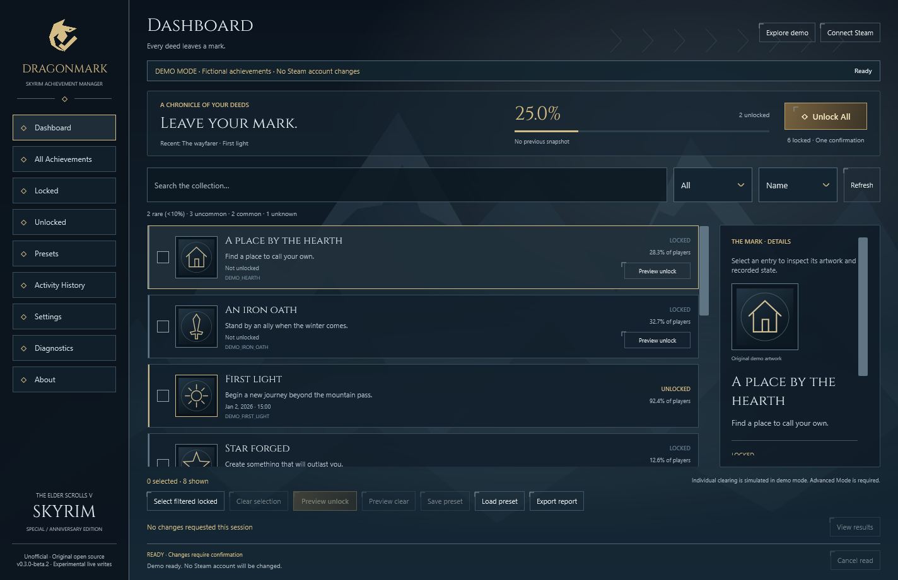
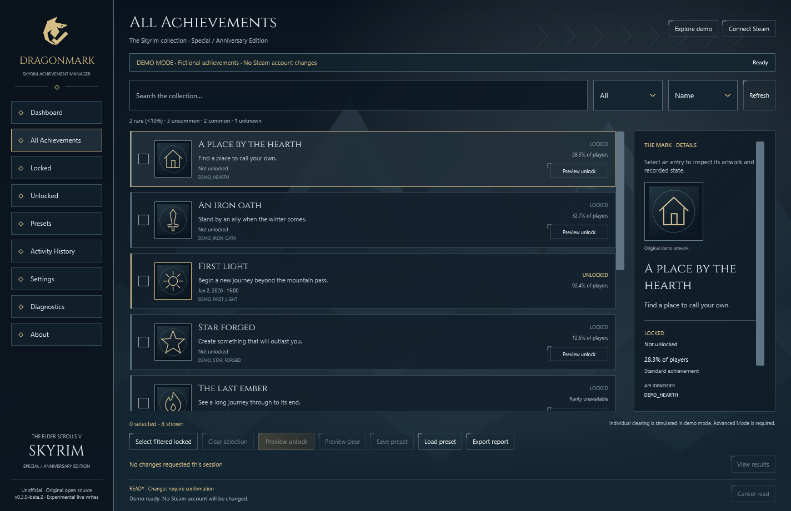

# Dragonmark 0.3.0-beta.2 · Skyrim Achievement Manager

This replaces the withdrawn beta.1 download. An audit found local build-directory paths in the PE debug metadata of four application DLLs. Release builds now disable debug metadata and map source paths to a neutral root. Packaging scans binary contents and refuses Windows profile paths, Steam account identifier patterns and private/debug files. No Steam account ID, settings, snapshot or activity log was found in the audited release payload. This fixes build metadata; achievement operation behavior is unchanged.

**Windows x64 beta — build metadata privacy fix.** Browse Skyrim SE/AE Steam achievements, inspect authentic artwork and unlock selected or all missing entries through one explicit confirmation.

The owner reported successful individual unlock and **Unlock All** tests on a real Steam account on 2026-11-09. Earlier read-only testing retrieved all 75 achievements and 75 current-state icons. This is local and owner-reported evidence; independent restart-persistence and broader-machine validation remain pending. Live clearing stays disabled.

## Download and install

Choose **Dragonmark-v0.3.0-beta.2-win-x64-Setup.exe** from this release's assets. Run Setup, keep **Download the verified Steam connection component** selected, and finish the wizard. .NET is included; no SDK or manual DLL copying is needed. Setup downloads the small pinned component from the official Steamworks.NET tag and verifies its SHA-256 before installing files. Internet is required for live setup. The native binary is not embedded in the installer.

Start Steam, sign in to your licensed Skyrim account, launch Dragonmark and select **Connect Steam**. No administrator rights, Steam password, SKSE or game-file patch is required. For offline demo, deselect the Steam component during Setup.

A portable ZIP is also attached; see [installation](docs/installation.md) for its separate Steam dependency setup. Verify either download against its accompanying `.sha256` file using `Get-FileHash -Algorithm SHA256`. The installer and app are unsigned; Windows may display an unknown-publisher warning.

## Highlights

- Original Nordic mountain atmosphere, licensed Cinzel typography, engraved controls and consistent achievement/detail/dialog styling.
- Authentic Steam artwork, matched by API identifier and current state with callback-driven caching.
- Dashboard **Unlock All** and Locked-page **Unlock Missing** target the complete refreshed missing set; no individual selection is needed.
- One explicit target-count confirmation, duplicate prevention, one StoreStats batch, callback and refreshed-state checks, and separate successful / failed / unverified results.
- Search, filters, rarity, unlock dates, presets, JSON/CSV reports, history, diagnostics and isolated Demo Mode.
- Reduced motion, optional local background artwork, English UI and English/Turkish documentation.
- Per-user installation, Start Menu and optional desktop shortcuts, and Windows uninstall support.
- Self-contained .NET 10.0.14, 69 passing automated tests, locked dependencies, manifest hashes and release checksums.

## Requirements and limitations

Windows x64 and, for live use, a running authenticated Steam client with Skyrim App ID 489830 are required. Windows 11 was tested locally; Windows 10, a separate AE installation, real per-monitor DPI, keyboard-only accessibility and failure/account-switch scenarios need broader testing. Original Skyrim, Skyrim VR and non-Steam editions are unsupported.

A timeout is not a rollback: uncertain writes can persist later, and the app blocks further writes in that session. No mass reset, save editing, telemetry or credential collection is implemented. Public screenshots use visibly labelled fictional Demo Mode data, not private Steam account data. No official Skyrim artwork or proprietary native binary is bundled.

See [validation](docs/VALIDATION.md), [changelog](CHANGELOG.md), [third-party notices](THIRD_PARTY_NOTICES.md) and [security](SECURITY.md).
