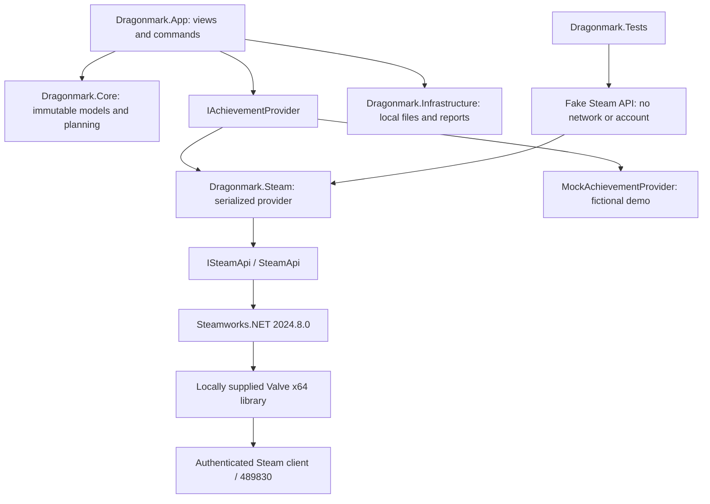
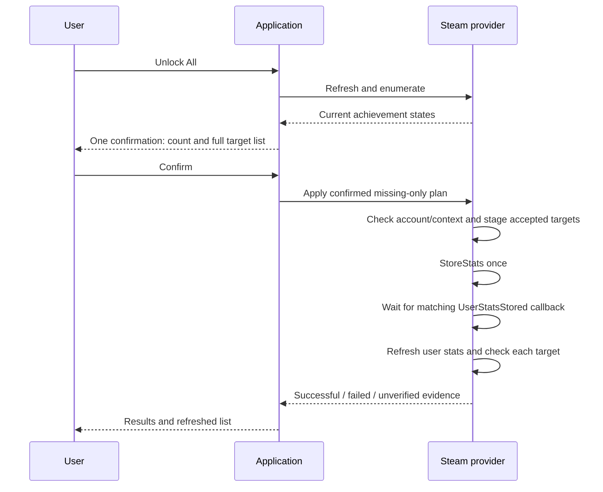

# Dragonmark architecture

Dragonmark is a Windows WPF app with constructor-injected providers. Its product name is **Dragonmark · Skyrim Achievement Manager**; project names and namespaces stay stable.

## Boundaries

| Project | Responsibility |
| --- | --- |
| App | WPF composition, view model, confirmation and outcome windows; English UI |
| Core | Achievement data, querying, selection, planning, outcomes, provider contract and demo |
| Steam | Native API facade, callback lifetime, account/context checks, deadlines and batch verification |
| Infrastructure | Settings, redacted logs, preset validation, exports and scoped snapshots |
| Tests | Behavior tests against fictional data and injectable fake APIs |

The dashboard's Unlock All command refreshes the full provider collection and builds a missing-only plan independent of display filters and selection. Unlock Missing shares that command. The UI sets its busy state before refresh/preview; the provider independently rejects concurrent operations. Canceling the confirmation makes no mutation.

## Write evidence

`SetAchievement` acceptance alone is insufficient. Successful store acknowledgement and matching refreshed state are both necessary for a successful outcome. Failed acceptance, explicit store rejection and missing verification retain their own evidence. Timeouts do not imply rollback. The provider blocks future writes after ambiguous persistence and enforces two-minute batch spacing.

Real standalone reads have local evidence. Live writes still require the [manual validation plan](LIVE_TEST_PLAN.md). The refreshed Steam cache is not an independently queried server. There is no SKSE bridge, C++ component, game injection, save editor or mass-reset path.

## Visual preview 0.3

Achievement entries now load authentic runtime artwork progressively with state-aware caching. Details and per-entry unlock actions share the same explicit preview flow. Settings includes reduced motion and optional local PNG/JPEG artwork. The About screen identifies original and third-party assets. See [visual design](visual-design.md) for callback matching, licensing, bounded image decoding and motion policy.
